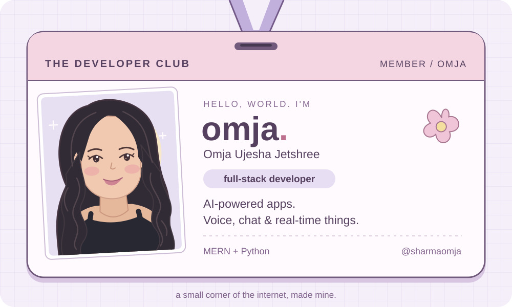

 
 

<a href="https://linkedin.com/in/omjasharma">linkedin ↗</a> &nbsp; · &nbsp;
<a href="https://instagram.com/rudeee_egg">instagram ↗</a> &nbsp; · &nbsp;
<a href="mailto:omjasharma15@gmail.com">say hello ♡</a>

 

### 🌷 behind the little ID card

I'm **Omja**, a full-stack developer building AI-powered products with **MERN and Python**. I work across interfaces, APIs, and the systems behind them — especially when there's a conversation involved.

My favorite problems live somewhere between **retrieval, voice, and real-time AI**.

 

### 🪄 what i'm building

- **AI-native apps** — full-stack products with LLMs in the loop.
- **Voice & chat interfaces** — streaming STT → LLM → TTS, with memory and tools.
- **RAG systems** — vector search, hybrid retrieval, and context-aware answers.
- **Scalable backends** — async APIs and event-driven systems.

 

### 🧸 the toolkit

| In my toolbox | Technologies |
| :--- | :--- |
| Languages | JavaScript · TypeScript · Python |
| Interfaces | React · Next.js · Tailwind CSS · React Native |
| APIs & real-time | Node.js · Express · Django · FastAPI · Socket.io |
| Data | PostgreSQL · MySQL · Redis · Prisma |
| AI | OpenAI · PyTorch · TensorFlow |
| Shipping & design | AWS · Vercel · Git · Figma |

A peek at the rest of my toolbox

 

**Languages:** C · Java · HTML · CSS  
**Frontend:** Three.js · MUI · Ant Design · DaisyUI · Styled Components · Framer · Vite · Web3.js  
**Backend:** Flask · JWT · Nginx · Apache · Gunicorn  
**Data & hosting:** Firebase · PlanetScale · Google Cloud · DigitalOcean · Netlify · Heroku  
**AI & data science:** Keras · Pandas · NumPy  
**Tools:** GitHub · Postman · Canva · Dribbble

 

### 🌱 currently curious about

**Agentic workflows**, retrieval reranking & evals, LLMOps & observability, and edge / real-time inference.

How can an assistant find better context, use the right tool, and respond without making you wait? That's the kind of thing I'm exploring.

 

---

Thanks for visiting my little corner of GitHub.

**Have something in mind? [Let's build it ↗](mailto:omjasharma15@gmail.com)**

